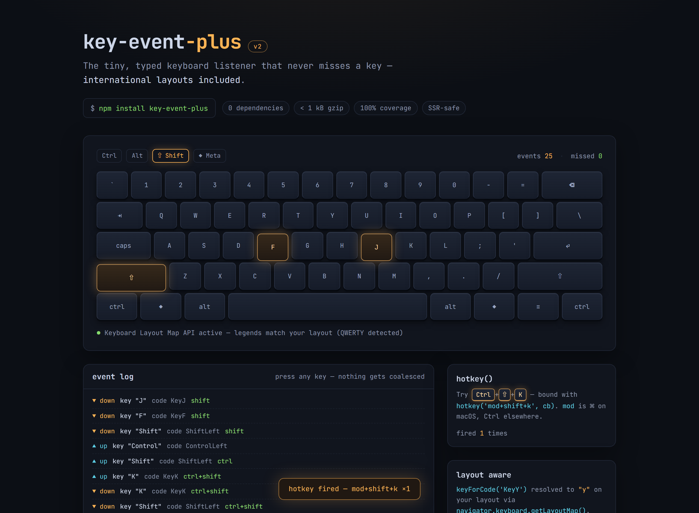

# key-event-plus

> The tiny, typed keyboard listener that never misses a key — international layouts included.

[](https://github.com/jeeanribeiro/key-event-plus/actions/workflows/ci.yml)
[](https://www.npmjs.com/package/key-event-plus)
[](.size-limit.json)
[](LICENSE)

[](https://jeeanribeiro.github.io/key-event-plus/)

**[▶ Try the live demo](https://jeeanribeiro.github.io/key-event-plus/)** — an interactive
keyboard visualizer importing this library: keys light up as you type, every event is logged,
nothing gets coalesced.

## Features

- **Event-driven, never misses a key** — subscribes to `keydown`/`keyup` directly. No polling
  loop, no sampling interval, no coalesced keystrokes.
- **Immutable events** — every callback receives a fresh, deeply frozen
  `{ key, code, state, repeat, modifiers }` snapshot. Store it, diff it, replay it.
- **Unsubscribe built in** — `onKey()` and `hotkey()` return a function that detaches everything.
- **`hotkey('mod+shift+k', cb)`** — the 80% case in one line. `mod` is ⌘ on macOS, Ctrl elsewhere.
- **International layouts** — combos match by layout character _and_ physical key position, and
  the Keyboard Layout Map API is exposed with sane fallbacks.
- **Tiny and typed** — zero dependencies, < 1 kB gzipped (enforced in CI by
  [size-limit](.size-limit.json)), strict TypeScript types, dual ESM/CJS.
- **SSR-safe** — no-ops cleanly without a `window`.
- **100% test coverage** — statements, branches, functions and lines, enforced by Vitest
  thresholds in CI.

## Quickstart

```sh
npm install key-event-plus
```

> npm currently serves v1; the v2.0.0 publish is in progress. Until it lands, the
> [v2.0.0 release](https://github.com/jeeanribeiro/key-event-plus/releases/tag/v2.0.0) tracks
> this repository.

```ts
import { onKey, hotkey } from 'key-event-plus'

const off = onKey((event) => {
  console.log(event.key, event.code, event.state) // "k" "KeyK" "down"
})

const offHotkey = hotkey('mod+shift+k', () => {
  console.log('command palette time')
})

// later
off()
offHotkey()
```

CommonJS works too:

```js
const { onKey } = require('key-event-plus')
```

## API

### `onKey(handler, options?) => Unsubscribe`

Subscribes to keyboard activity. The handler is called with an immutable `KeyEvent` and the
native `KeyboardEvent` (escape hatch for `preventDefault()` etc.).

```ts
const off = onKey(
  (event, native) => {
    event.key // layout-aware value ("k", "л", "ü", "Escape"…)
    event.code // physical position ("KeyK", "Digit1", "ShiftLeft"…)
    event.state // 'down' | 'up'
    event.repeat // true while auto-repeating
    event.modifiers // { alt, ctrl, meta, shift } snapshot
  },
  { target: window, preventRepeat: false },
)
```

| Option          | Type          | Default  | Description                          |
| --------------- | ------------- | -------- | ------------------------------------ |
| `target`        | `EventTarget` | `window` | Where to attach the listeners.       |
| `preventRepeat` | `boolean`     | `false`  | Skip auto-repeated `keydown` events. |

Every emission is a **new, deeply frozen object** — callbacks never see shared mutable state.

### `hotkey(combo, handler, options?) => Unsubscribe`

Runs `handler` when the combo is pressed (fires on `keydown` only; modifiers must match
exactly, so `mod+k` does not fire on `mod+shift+k`).

```ts
hotkey('mod+shift+k', openPalette, { preventDefault: true })
```

| Token                                                           | Meaning                              |
| --------------------------------------------------------------- | ------------------------------------ |
| `mod`                                                           | ⌘ on macOS/iOS, Ctrl everywhere else |
| `ctrl` / `control`                                              | Control                              |
| `alt` / `option`                                                | Alt / Option                         |
| `shift`                                                         | Shift                                |
| `meta` / `cmd` / `command` / `super` / `win`                    | Meta / Command / Windows key         |
| `esc`, `space`, `plus`, `return`, `up`, `down`, `left`, `right` | Key aliases                          |

Options are `onKey`'s plus `preventDefault?: boolean` (default `false`).

**Layout resilience:** single letters and digits also match by physical key position
(`KeyboardEvent.code`), so `mod+k` keeps firing on a ЙЦУКЕН layout where the same physical key
produces `л`.

### Layout helpers

```ts
import { supportsLayoutMap, getLayoutMap, keyForCode } from 'key-event-plus'

supportsLayoutMap() // true in Chromium-based browsers
await getLayoutMap() // ReadonlyMap<code, key> (empty map where unsupported)
await keyForCode('KeyY') // "y" on QWERTY, "z" on QWERTZ, "н" on ЙЦУКЕН
```

Where the [Keyboard Layout Map API](https://developer.mozilla.org/docs/Web/API/KeyboardLayoutMap)
is unavailable (Firefox, Safari, SSR), `keyForCode` falls back to deriving `KeyA`–`KeyZ` and
`Digit0`–`Digit9` from the code and returns `undefined` for anything it cannot know — it never
guesses.

### SSR

All entry points are safe to call without a `window`: `onKey`/`hotkey` return a no-op
unsubscribe, `supportsLayoutMap()` is `false`, and `getLayoutMap()` resolves to an empty map.
No `typeof window` guards needed in your code.

## The international layout problem

Keyboard handling has two identities per key, and mixing them up breaks non-US users:

- **`event.key`** is what the key _produces_ on the active layout: `y` on QWERTY is `z` on
  QWERTZ; `KeyK` produces `л` on ЙЦУКЕН; AZERTY swaps `a`/`q`.
- **`event.code`** is the _physical position_ and never changes with layout.

Historically libraries leaned on the deprecated `keypress` event or on `keyCode`, both of which
mangle international input (and `keypress` never fires for modifiers at all). v1 of this
library polled on a timer to try to reconcile the two — v2 solves it properly:

1. Events carry **both** `key` and `code`, straight from `KeyboardEvent` semantics.
2. `hotkey()` matches the layout character first, then falls back to the physical position for
   letters and digits — shortcuts survive layout switches.
3. `getLayoutMap()`/`keyForCode()` expose the browser's own physical-to-character mapping where
   it exists, with honest fallbacks where it doesn't.

## Size

Enforced by [size-limit](.size-limit.json) on every CI run:

| Import           | Cost (min + gzip) | Budget |
| ---------------- | ----------------- | ------ |
| everything       | ~930 B            | 1 kB   |
| `{ onKey }` only | ~380 B            | 450 B  |

## Development

```sh
pnpm install
pnpm test        # vitest (happy-dom, synthetic KeyboardEvents)
pnpm coverage    # enforces 100% statements/branches/functions/lines
pnpm lint        # eslint + prettier
pnpm typecheck   # tsc --noEmit
pnpm build       # tsup → dist (ESM + CJS + d.ts)
pnpm size        # size-limit budgets
pnpm dev         # keyboard visualizer demo on :43110
pnpm capture     # rebuild demo + refresh the README screenshot
```

## Migrating from v1

v1's `keyEventListener(ms, callback)` polling API is gone. The
[migration guide](docs/migrating-from-v1.md) maps every v1 behavior to its v2 replacement —
most call sites become one `onKey()` call with no timer tuning.

## Roadmap

- Key sequence support (`g g`, konami-style chords)
- Scoped hotkey groups with enable/disable
- Optional `capture`/`passive` listener options

## Contributing

PRs welcome — see [CONTRIBUTING.md](CONTRIBUTING.md). Releases go through
[Changesets](RELEASING.md).

## License

[MIT](LICENSE) © Jean Ribeiro
